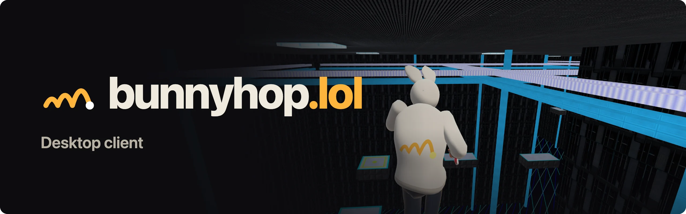
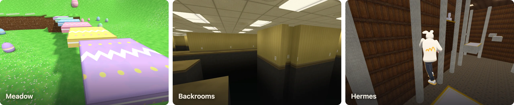
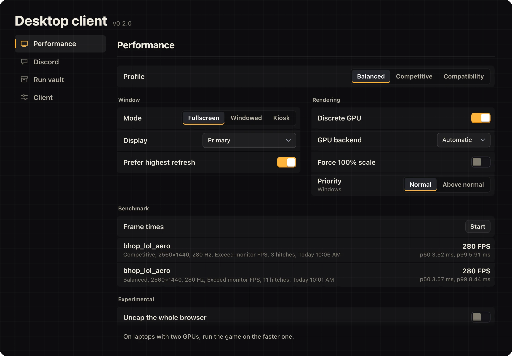

<p align="center">
  
</p>

<p align="center">
  <a href="https://github.com/8tp/bunnyhop-client/releases/latest"><b>Download</b></a>
  &nbsp;&nbsp;&nbsp;
  <a href="https://bunnyhop.lol">Play in the browser</a>
  &nbsp;&nbsp;&nbsp;
  <a href="https://discord.gg/bhoplol">Discord</a>
  &nbsp;&nbsp;&nbsp;
  <a href="docs/client.md">How it works</a>
</p>

<br>

[bunnyhop.lol](https://bunnyhop.lol) is a bunnyhop game with Source movement that runs in the browser. This client gives it a window of its own on Windows, macOS and Linux.

It plays the same game, loaded from the live site. Sign in with the same account and your runs and ranks are there. The client never touches movement or input, so a run counts the same in the client and in the browser.



## What it adds

- **Its own window.** Fullscreen on the display you choose, the faster GPU on laptops, and a profile for each kind of machine.
- **Discord.** Your status shows the map you're on. Friends can press Join on your profile to land on your server.
- **A run vault.** Every finished run is saved on your computer, with a screenshot of each personal best if you want one.
- **A benchmark.** Measure 30 seconds of play and compare settings with numbers instead of feel.
- **Maps that load once.** Maps and their textures stay on disk, so the next load skips the download.
- **`bunnyhop://` links** that open a map, a server or a replay.



## Install

Download the file for your system from the [latest release](https://github.com/8tp/bunnyhop-client/releases/latest).

| System | File |
| --- | --- |
| Windows 10 and 11 | `Bunnyhop-<version>-win-x64-setup.exe`, or the portable `-win-x64.zip` |
| macOS 13 or newer | `-mac-arm64.dmg` for Apple silicon, `-mac-x64.dmg` for Intel |
| Linux | `-linux-x86_64.AppImage`, or the `-linux-amd64.deb` |

The builds aren't signed with a paid certificate, so Windows and macOS ask once before the first launch of each version.

<details>
<summary><b>Windows</b></summary>

<br>

The installer sets up Bunnyhop for your account only, with no administrator prompt. If "Windows protected your PC" appears, choose **More info**, then **Run anyway**.

For the portable copy, extract the zip and run `Bunnyhop.exe`.

Windows 11 with Smart App Control turned on blocks unsigned apps entirely. Play in the browser instead.

</details>

<details>
<summary><b>macOS</b></summary>

<br>

Open the DMG and drag Bunnyhop to Applications. macOS refuses the first launch. Open **System Settings → Privacy & Security**, scroll to the message about Bunnyhop, choose **Open Anyway**, and confirm.

After an update, macOS may ask once for access to "Bunnyhop Safe Storage". Choose **Always Allow**.

</details>

<details>
<summary><b>Linux</b></summary>

<br>

```sh
chmod +x Bunnyhop-*-linux-x86_64.AppImage && ./Bunnyhop-*-linux-x86_64.AppImage
# or
sudo apt install ./Bunnyhop-*-linux-amd64.deb
```

</details>

Every release lists its files' checksums in `SHA256SUMS`. The client tells you when a new version is out. It never downloads or installs anything by itself.

## Keys

| Key | Does |
| --- | --- |
| <kbd>F10</kbd> | Client settings |
| <kbd>F11</kbd> | Fullscreen |
| <kbd>F9</kbd> | Save a screenshot |

## Build from source

You need Node.js 22 or newer.

```sh
npm ci
npm start
```

`npm run verify` runs the checks and tests. Everything else is in [development](docs/development.md).

## More

- [How the client works](docs/client.md): profiles, Discord, the run vault, files on disk, links
- [Development](docs/development.md): scripts, layout, the bridge to the game
- [Releases](docs/releases.md) and the [roadmap](docs/roadmap.md)
- [Changelog](CHANGELOG.md)

Found a bug? [Open an issue](https://github.com/8tp/bunnyhop-client/issues) and attach the support report from F10 → Client. Security problems go through [SECURITY.md](SECURITY.md).

The client is [MIT licensed](LICENSE). This repository holds only the desktop shell; the game, its maps and servers live in a separate project.
